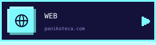
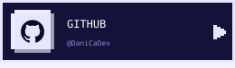

<!--
  Perfil estilo "pantalla de inicio retro".
  Los SVG de assets/ los genera build.py (fuente incrustada y animaciones CSS).
  El bloque de redes se genera desde redes.json.
  Las estadísticas se actualizan a diario con .github/workflows/estadisticas.yml.
-->

<!-- Cabecera -->

  

<!-- GIF (pendiente de añadir assets/anime.gif)

  

-->

<!--
  Menú: cada botón es un SVG dentro de un <a>, porque los enlaces dentro
  de un SVG no funcionan en GitHub.
-->

   
   
   
  

 

<!--
  Los títulos son imágenes, así que GitHub no genera anclas para ellos:
  cada sección lleva su <a name> para que funcionen los botones del menú.
-->

  

  

 

  

  

 

  

<!-- Generado por build.py desde redes.json: no editar a mano -->
<!-- REDES:INICIO -->

  
  
  
  

<!-- REDES:FIN -->

 

<!-- Pie -->

  

