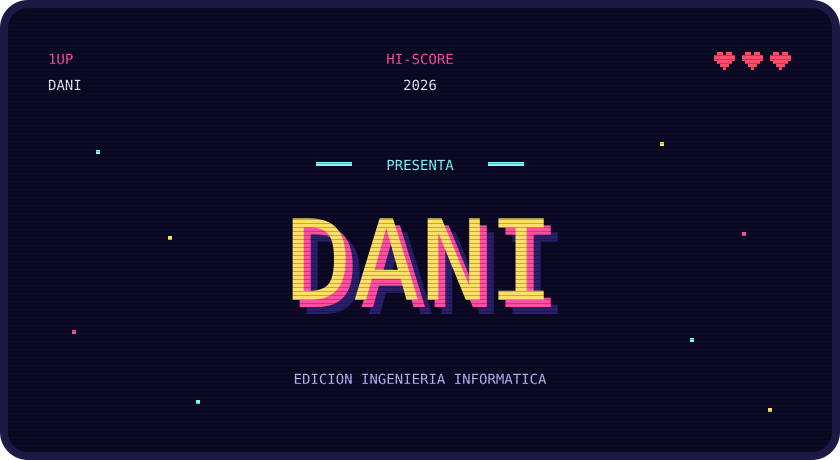
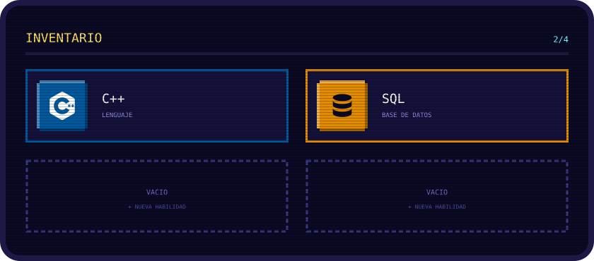

<!--
  Perfil estilo "pantalla de inicio retro".
  Los SVG de assets/ los genera build.py (fuente incrustada y animaciones CSS).
  Las estadísticas se actualizan a diario con .github/workflows/estadisticas.yml.
-->

<!-- Cabecera -->

  

<!-- GIF aparte, fuera del SVG, para que se anime en todos los navegadores -->

  

<!--
  Menú: cada botón es un SVG dentro de un <a>, porque los enlaces dentro
  de un SVG no funcionan en GitHub. Los anclas (#habilidades, #contacto)
  los genera GitHub a partir de los títulos.
-->

   
   
   
  

 

## Habilidades

<!-- Generado desde habilidades.json -->

  

## Estadísticas

<!-- Contribuciones del último año y rachas; se actualiza solo -->

  

## Contacto

  <a href="https://panikoteca.com">panikoteca.com</a> ·
  <a href="https://www.linkedin.com/in/daniel-alejandro-%C3%A1lvarez-casablanca-b223b9240/?isSelfProfile=true">LinkedIn</a> ·
  <a href="daniicadev@gmail.com">Email</a>

<!-- Pie -->

  

